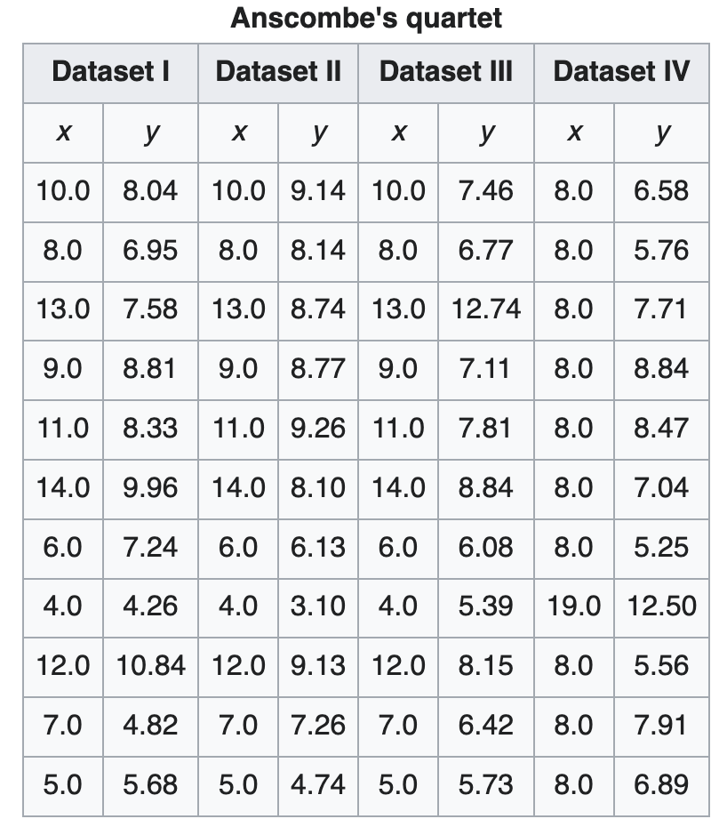
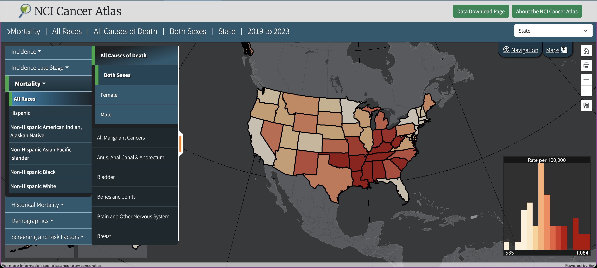

# Chapter 1: Graphical Excellence
**Excellence** means to communicate complex ideas with clarity, precision, and efficiency
* Encourage the viewer to analyze the data: compare, zoom in/out
* Compact/summarize big datasets

Graphics *reveal* data
* [Anscombe's Quartet](https://en.wikipedia.org/wiki/Anscombe%27s_quartet) (published 1973): all four datasets below have the same statistical features (x-mean, y-mean, variance, correlation, etc.) but visually look very different when visualized:
    

    

**Bivariate scatterplot**: displays the relationship between two quantities (plotted on the x-axis and y-axis)
* We can immediately see outliers A and B when plotted:
    
* **Marginal distribution** - the probability distribution of a variable (x or y), independent of the other variable
    * The marginal distribution of the outliers A and B might not reveal the outlier

The data graphic can only be as good as its dataset
* A visual cannot rescue a small dataset or a bad data model
* Example of a **spurious correlation** - when a dataset only *appears* to be correlated, but only due to coicidence, with no proof of an actual cause-effect
    * Ex) New York stock prices and solar radiation
    
* Website of [spurious correlations](https://www.tylervigen.com/spurious-correlations) 笑

## Data Maps
* [National Cancer Institute (NCI) Cancer Atlas](https://gis.cancer.gov/canceratlas/) - shows the map of cancer rates by state, cancer type, and demographics
    
* The book originally points to the maps in [Cancer rates by US county (1973)](https://www.science.org/doi/10.1126/science.1220005) (but blocked by a paywall 😢)
    * Can analyze regional hotspots for different types of cancer
    * Cancer and common occupations (ex. highest rate of bladder cancer at the time of publishcation was in Salem County, NJ - there were many workers in the chemical industry)
* Need to be careful with data maps:
    * The viewer assumes geographic size is related to population/importance
    * Our attention goes straight to exploring the data on the map, and not *how* the data was collected
        * Ex) How was the cause of death determined? Differences in how cancers are diagnosed in different geographic area or doctor

Data maps, the combination of statistics and cartography, first appeared in the 17th century, 5,000 years after the first maps were drawn on clay tablets
* Yü Chi Thu map, 11th century AD in China
    
    * Precision of river networks and coast was very advanced for its time
    * Nothing like this existed in Europe until the 1500s

* 1546 edition of *Cosmographia* by Petrus Apianus showed various European cities relative to each other in distance
    * (not the map but the artwork is really pretty)
    

* 1786 - first economic time series plotted
* 1686 - Edmond Halley's map on trade winds and monsoons on a world map:
    
    * One of the earliest data maps
    * 💡 Quantum circuits + wind maps?
* 1854 - Dr. John's Snow's dot map of cholera deaths in Central London
    
    * Water pumps are marked as an `x`, and observed that most deaths occurred near the Broad Street water pump
        * This waterpump was removed, ending the epidemic that killed 500+ people
* 1864 - Charles Joseph Minard applied quantity and direction in this wine export map:
    
    * ❓ Does thickness correlated with how much wine was exported to that destination?

Computers allow an enormous density of information compared to Halley's wind map from 1686
* [Mapping the galaxies of the universe](https://ui.adsabs.harvard.edu/abs/1977AJ.....82..249S/abstract)
